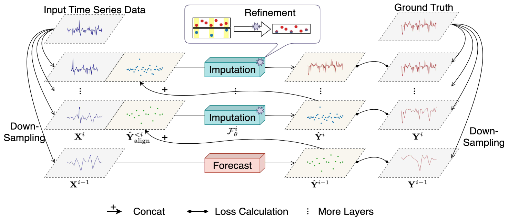

<div align="center">

# MSAR

### Next-Scale Autoregressive Forecasting for Time Series via Modular Multi-Scale Decoupling

[Paper](https://openreview.net/forum?id=ryJy1ZX3II) · Forecasting framework and reproducible code

</div>

<p align="center">
  
</p>

MSAR is a modular, model-agnostic framework for time-series forecasting. It
forecasts progressively from coarse to fine temporal scales: coarse forecasts
guide finer-scale models, which refine the predictions at higher resolution.

This repository includes a shared training pipeline for single-scale baselines
and MSAR-enhanced models.

## Supported backbones

| Backbone | Baseline | + MSAR |
|---|:---:|:---:|
| PatchTST | ✓ | ✓ |
| DLinear | ✓ | ✓ |
| TimeMixer | ✓ | ✓ |
| iTransformer | ✓ | ✓ |
| TimesNet | ✓ | ✓ |
| SimpleTM | ✓ | ✓ |
| DUET | ✓ | ✓ |

## Usage

### 1. Environment setup

Use Python 3.9 or newer. Install a [PyTorch build compatible with your CUDA environment](https://pytorch.org/get-started/locally/), then install the remaining requirements:

```bash
pip install -r requirements.txt
```

### 2. Data preparation

The included loaders support ETTh1, ETTh2, ETTm1, ETTm2, and custom CSV files.
For ETTh1, place the CSV here:

```text
./dataset/ETT-small/ETTh1.csv
```

CSV files should have a `date` column followed by numeric time-series columns.
For other ETT datasets, set `--data` and `--data_path` to the matching dataset;
use `--freq t` for ETTm data. For custom data, pass `--data custom` together
with `--root_path`, `--data_path`, `--target`, and `--freq`.

### 3. Training and evaluation

Run commands from the repository root. The default training loss is MAE and the
default initial learning rate is `1e-3`.

**Baseline** — single scale (`interval_list=1`):

```bash
python run.py \
  --model PatchTST \
  --data ETTh1 --root_path ./dataset/ETT-small --data_path ETTh1.csv \
  --seq_len 336 --label_len 0 --pred_len 96 \
  --interval_list 1 --seq_len_list 336 \
  --loss MAE
```

**MSAR** — coarse scale followed by full-resolution refinement:

```bash
bash scripts/run_msar.sh
```

The example uses `interval_list=6,1`, `seq_len_list=56,336`, and enables slim
imputation (`d_model=16`, `d_ff=32`). Set `MODEL` to choose a different
backbone, for example:

```bash
MODEL=TimeMixer bash scripts/run_msar.sh
MODEL=DLinear bash scripts/run_msar.sh
MODEL=SimpleTM bash scripts/run_msar.sh
```

**DUET:** slimming the imputation model is not recommended based on our width
comparison. The script automatically leaves DUET full-width:

```bash
MODEL=DUET bash scripts/run_msar.sh
```

To train with MSE, pass `--loss MSE` to `run.py` or edit the example script.
Use `python run.py --help` for model-specific parameters. The available
backbones and MSAR training stages are implemented in `models/` and `exp/`.

## Outputs

- Checkpoints: `./checkpoints/`
- Test metrics: appended to `./results.txt` by default; change with `--result_file`
- Dataset, checkpoint, and generated result files are excluded by `.gitignore`.

## Citation

If you use MSAR, please cite:

```bibtex
@inproceedings{fan2026msar,
  title     = {{MSAR}: Next-Scale Autoregressive Forecasting for Time Series via Modular Multi-Scale Decoupling},
  author    = {Fanda Fan and Kuiye Ding and Liming Mao and Bingsong Wang and
               Yao Wang and Xiaorui Wang and Ruijie Jian and Zhipeng Liu and
               Luqi Gong and Zhenghua Lu and Chunjie Luo and Jianfeng Zhan},
  booktitle = {The Fortieth Annual Conference on Neural Information Processing Systems},
  year      = {2026},
  url       = {https://openreview.net/forum?id=ryJy1ZX3II}
}
```

Fanda Fan and Kuiye Ding contributed equally. Luqi Gong is the corresponding
author.

## Acknowledgements

This code is adapted from the [MSAR implementation](https://github.com/fanfanda/MSAR)
and uses forecasting backbones also available in the
[Time-Series-Library](https://github.com/thuml/Time-Series-Library). The source
snapshot did not include a license file; see [UPSTREAM.md](UPSTREAM.md) and
confirm upstream licensing terms before redistributing the code.
